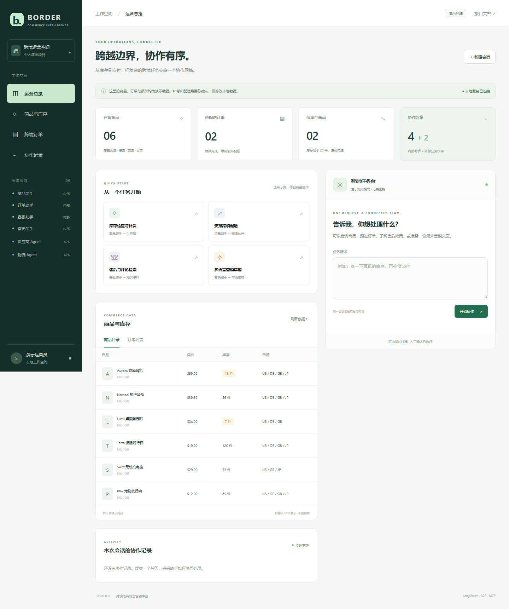
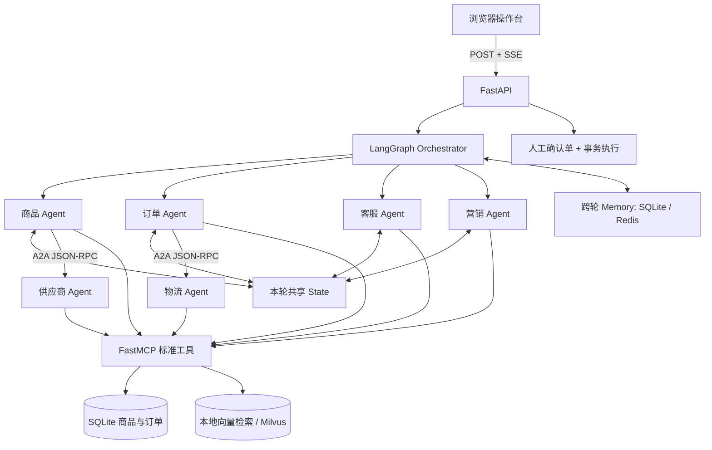

# BORDER · 跨境电商混合智能中台

把商品、订单、客服、营销放进同一个协作网络：内部用 **LangGraph** 共享任务状态，外部用 **A2A** 委派供应商和物流任务，业务接口统一封装为 **FastMCP** 工具，页面通过 **SSE** 展示处理过程。

这是一个可本地运行的学习与面试演示项目。提供 6 个商品、4 个订单、评论、营销素材和售后政策。**所有业务数据均为合成数据，没有接入真实店铺，不会付款、下采购单或向真实物流发货。**



操作界面采用跨境物流作业台风格：顶部导航、目的市场线路图、横排数据、深色任务区和清单式商品表。线路图下方可切换美国、德国、英国、日本，筛选对应商品与订单；选择市场后，快捷营销指令会使用该市场。线路为示意图，不代表实时运输状态。

## 先把项目跑起来

想直接分享网址？已提供 [Render 免费演示部署](docs/deploy-free.md)，包含访问密码保护和临时数据提示。

[一键前往 Render 部署](https://render.com/deploy?repo=https%3A%2F%2Fgithub.com%2Fsir-svg%2Fcrossborder-commerce-agent-hub)

线上打开网址会进入登录页，使用 `demo` 和原有访问密码登录。支持显示/隐藏密码、错误提示、登录保持和退出登录。[查看登录页面](docs/login-preview.png)

需要 Python 3.11～3.13 和 [uv](https://docs.astral.sh/uv/getting-started/installation/)。推荐 Python 3.13。首次安装依赖需要联网，之后默认演示模式不需要模型密钥或 Docker。

```powershell
git clone https://github.com/sir-svg/crossborder-commerce-agent-hub.git
cd crossborder-commerce-agent-hub
uv sync --frozen
uv run uvicorn app.main:app --host 127.0.0.1 --port 8000
```

打开 **http://127.0.0.1:8000** 使用操作台；**http://127.0.0.1:8000/docs** 查看接口说明。

Windows 也可以进入项目文件夹，右键 `start.ps1` 选择“使用 PowerShell 运行”，或运行 `powershell -ExecutionPolicy Bypass -File .\start.ps1`。如果没有 uv，先执行 `python -m pip install uv`。

如果暂时不想用 Git，点击仓库页面的 **Code → Download ZIP**，解压后在项目文件夹执行上面的 `uv sync` 和启动命令。

## 四条演示主线

| 输入示例                            | 可以看到什么                                                               |
| ----------------------------------- | -------------------------------------------------------------------------- |
| 查询 SKU-1001 的库存，并补货50件    | 商品助手查询目录，通过 A2A 委派供应商，再调用 MCP 库存工具，生成补货确认单 |
| 查看订单 CB-2026002，安排配送       | 订单助手读取订单，通过物流 A2A Agent 估算运费和时效，生成配送确认单        |
| SKU-1001 的退货政策是什么？看看评论 | 客服助手检索政策和商品评论，返回来源编号                                   |
| 为 SKU-1002 生成德国市场的营销文案  | 营销助手读取素材，生成中文、英文和德文草稿，不自动发布                     |

再输入“再写一份营销文案”，可复用当前会话中的商品与市场。最近对话和结果在服务端保存，刷新页面后可在作业记录里展开查看。点击“新建会话”开始独立记忆；会话标识保存在浏览器的 sessionStorage 中。

补货和配送必须点击 **确认执行演示操作** 才会改变本地数据。重复确认同一张单不会重复补货或重复扣库存；确认时也会重新检查库存和订单状态。配送确认后出现的是 `DEMO-` 开头的模拟运单。

## 架构与边界



- **内部紧耦合**：四类节点共享 `entities/results/proposals`，调度器决定执行顺序。订单先执行，把商品和目的地传给客服、商品或营销节点。
- **外部松耦合**：供应商和物流通过 Agent Card 发现能力，使用官方 A2A SDK 的 Task、Artifact 和 JSON-RPC 交互。默认用 ASGI transport 在进程内跑完整协议；配置地址后切换成独立 HTTP 服务。
- **统一工具**：6 个真实注册的 FastMCP 工具：`search_products`、`get_order`、`list_orders`、`search_knowledge`、`supplier_inventory`、`shipping_quote`。默认 Client 使用进程内传输，也支持 Streamable HTTP。
- **记忆**：本轮状态由 LangGraph 共享；跨轮商品、订单和市场保存到 SQLite 或 Redis。这里没有实现 LangGraph checkpoint 的中断恢复。
- **流式输出**：节点开始发送 `activity`，完成发送 `step`；模型汇总时转发真实的 `token`，最终发送 `result` 和 `done`。页面显示实际模型用量、降级情况、工具事实与资料原文。

### 大模型与无密钥演示

没有配置密钥时使用关键词路由和固定文案，页面明确标注规则演示。配置密钥后，**DeepSeek 实际参与任务规划、商品分析、订单分析、售后回答、营销文案和最终回复**。业务查询仍经 A2A/MCP 执行，模型不能直接改库存、发货或退款。

如需模型辅助，把 `.env.example` 复制为 `.env`，配置支持 Chat Completions 格式的服务：

```dotenv
LLM_BASE_URL=https://ws-wx3zg6zl1sf52rk4.cn-beijing.maas.aliyuncs.com/compatible-mode/v1
LLM_API_KEY=在这里填写自己的密钥
LLM_MODEL=deepseek-v4.1-flash-1017
```

地址和模型名已有上述默认值；线上在 Render 的 **Environment** 中添加 `LLM_API_KEY`，保存并部署即可。密钥只放本机 `.env` 或 Render 环境变量，不上传 GitHub。[详细配置与试用](docs/model-setup.md)。

模型能理解“那款降噪耳机再进五十个”“把背包库存补到一百件”，也能根据当前会话追问和目标市场撰写文案。缺少数量时会追问，未知编号不会被偷偷替换；模型结构化结果、动作证据和资料来源经过程序检查。模型回答仍可能出错，展开“查询事实与资料来源”核对库存、价格和政策；确认单数量才是实际演示操作使用的值。

单轮通常调用模型3次，多助手任务最多6次；临时服务错误可能额外重试一次。页面显示服务商返回的 Token 用量，不估算费用。模型失败时明确提示降级，并保留工具查询结果。调用时会向所配置的服务商发送本轮问题、最近对话和查询资料；不发送登录密码或模型密钥作为对话内容。Render 计算可以免费，**模型调用费用由阿里云账号规则决定**。

## 切换独立 A2A 与 MCP 服务

在四个终端分别运行（先运行三个外部服务，再启动主应用）：

```powershell
uv run python -m app.services mcp
uv run python -m app.services supplier
uv run python -m app.services logistics
uv run uvicorn app.main:app --host 127.0.0.1 --port 8000
```

在启动前把 `.env` 设置为：

```dotenv
MCP_URL=http://localhost:8003/mcp
SUPPLIER_URL=http://localhost:8001
LOGISTICS_URL=http://localhost:8002
```

两个外部服务的 Agent Card 分别在 `http://localhost:8001/.well-known/agent-card.json` 和 `http://localhost:8002/.well-known/agent-card.json`。默认单进程服务也公开 `/agents/supplier/` 和 `/agents/logistics/` 的 JSON-RPC 入口及其 `.well-known/agent-card.json`。

协议固定为 **A2A 0.3**，使用 `a2a-sdk<0.4`。这是明确的版本选择；不宣称支持 A2A 1.0 全部行为。当前只使用非流式 `message/send` 完成短任务，Task Store 为进程内存，重启后不保留外部任务；面向页面的 SSE 由主应用提供。

## Redis 与 Milvus

默认 SQLite 持久化会话实体，本地哈希向量检索政策与素材。若要体验 Redis 和 Milvus，安装 [Docker Desktop](https://www.docker.com/products/docker-desktop/) 后运行：

```powershell
docker compose --profile infra up -d redis etcd minio milvus
uv sync --frozen --extra milvus
```

在 `.env` 中设置：

```dotenv
MEMORY_BACKEND=redis
REDIS_URL=redis://localhost:6379/0
KNOWLEDGE_BACKEND=milvus
MILVUS_URI=http://localhost:19530
```

再启动主程序。Redis 会话有效期为7天；Milvus 启动时自动创建演示 collection 并按固定文档 ID 幂等写入。**向量采用256维词/字双元组哈希，不是语义 embedding 模型**；后续可替换 `app/knowledge.py` 的 `embed()`，更换向量维度时需新建 collection。资料规模很小，当前 Milvus 查询后会按商品归属筛选；生产数据应改为服务端过滤和正式的 embedding 方案。选择 Redis 或 Milvus 后连接失败会直接报错，不悄悄回退成本地模式。

只用容器运行基础演示：`docker compose up --build app`。它默认采用 SQLite、本地检索和进程内协议调用，不依赖 infra 服务。

## 主要文件

```text
app/
  main.py           HTTP 接口、SSE 和服务生命周期
  workflow.py       LangGraph 路由与四类助手
  external.py       供应商/物流 A2A 服务和委派客户端
  tools.py          FastMCP 工具与客户端
  store.py          演示数据、确认单、事务与幂等处理
  memory.py         SQLite / Redis 会话实体
  knowledge.py      本地 / Milvus 检索
  llm.py            模型调用、真实流式输出、用量与错误处理
  planning.py       任务计划、中文数量与动作校验
  analysis.py       四类助手提示词、文案与来源校验
  seed.json         商品、订单、政策、评论与素材
  static/           无需前端构建的操作页面
tests/              业务与协议测试
docs/               架构、接口和演示讲解
```

## 检查代码

```powershell
uv sync --frozen --extra dev
uv run pytest -q
uv run ruff check app tests
uv run ruff format --check app tests
```

更多接口示例见 [接口说明](docs/api.md)，面试讲解顺序见 [演示讲解](docs/demo-guide.md)。
已运行的检查与尚未验证的可选组件见 [验证记录](docs/validation.md)。

## 当前范围与后续方向

这一版可演示协议协作和业务闭环，但尚未接入 Amazon、Shopify 等真实平台，也未实现支付、退税、真实报关与履约。运费、时效、评价均为模拟值，不能用作交易或合规依据。

当前是单用户演示，没有角色权限和真实租户隔离；会话 ID 不能代替身份认证。本机默认绑定 `127.0.0.1` 并免登录。在线演示使用 `PUBLIC_DEMO=true`，必须设置至少12位的 `DEMO_PASSWORD`，通过网页登录表单进入；HttpOnly 会话最长8小时有效，支持退出登录，服务重启后需重新登录。密码和会话令牌不放入浏览器本地存储。未配置密码的本机模式不能直接暴露到公网。跨进程执行使用同一个 SQLite 文件，完整生产方案还需要数据库升级、分布式任务锁、独立用户认证、可观测性和外部写入幂等。

后续接入真实系统时，在 MCP 适配层替换模拟数据，在 A2A 边界增加服务认证，把人工确认后的本地事务替换为带幂等键的真实履约任务。页面刷新后可恢复最近20轮问答和待确认单；当前逐节点协作列表不持久化，Render 临时数据重置后历史也会清空。
